# Testes Caixa Cinza em API de Autenticação – Supabase + Postman

**Aluno:** Nicolas Gomes Ferreira
**RA:** 251141
**Curso:** Análise e Desenvolvimento de Sistemas – Facens
**Disciplina:** UX/UI e Testes de Software
**Data:** 06/11/2026

---

# Introdução

Este repositório documenta a execução de testes **caixa cinza** sobre a API de autenticação do **Supabase**, usando o **Postman Desktop** como ferramenta de teste. Nesse tipo de teste o testador conhece parte da estrutura do sistema (endpoint, headers, formato do body e respostas HTTP esperadas), mas não tem acesso ao código-fonte interno do serviço de autenticação.

Estrutura do repositório:

```
/README.md     → documentação completa da atividade
/postman/      → collection e environment exportados do Postman
/prints/       → evidências (capturas de tela) dos testes
/planilha/     → planilha de registro dos testes
```

# Objetivo da Atividade

Compreender e aplicar testes caixa cinza em uma API de autenticação, passando por:

- configuração de um ambiente de autenticação no Supabase;
- criação de usuário para testes;
- montagem de requisições HTTP no Postman;
- execução de cenários válidos e inválidos de login;
- validação de status HTTP, respostas JSON, mensagens de erro e access token;
- documentação técnica de todo o processo.

# Configuração do Supabase

### Criação do projeto

Criei uma conta no [Supabase](https://supabase.com), criei a organização **auth-testes-nicolas** (plano Free) e, dentro dela, um novo projeto (ID `dihztjrqlbuvlsfbuqhj`) hospedado na região **South America (São Paulo) – sa-east-1**. O Supabase gera para cada projeto um banco PostgreSQL e um serviço de autenticação (GoTrue), acessível pela rota `/auth/v1`.

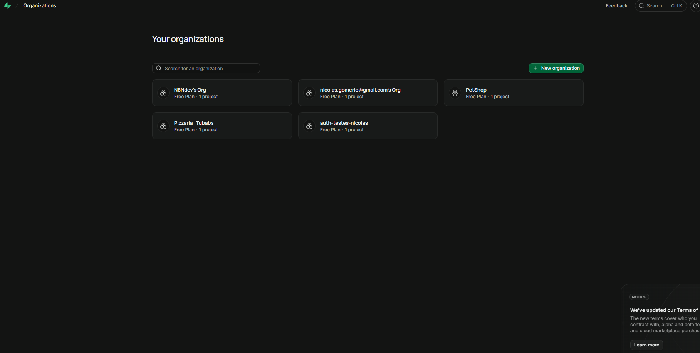
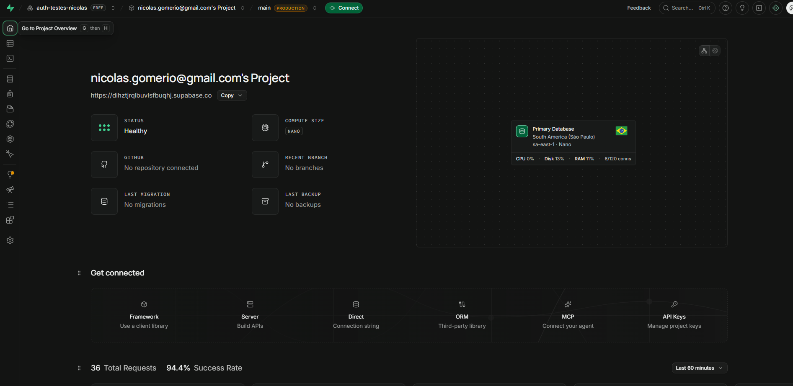

### Tipo de autenticação

Utilizei a autenticação por **e-mail e senha** (provider *Email*), em **Authentication → Sign In / Providers**. Esse provider já vem habilitado por padrão. Conferi que ele estava ativo.

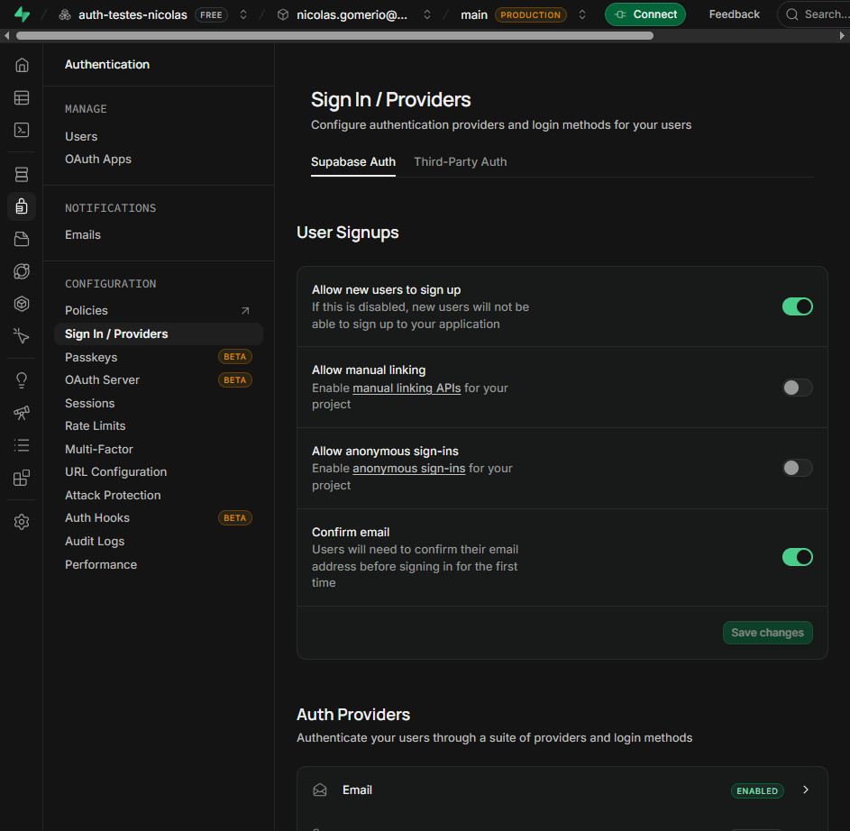

### Criação do usuário de teste

Em **Authentication → Users → Add user → Create new user**, cadastrei o usuário `nicolas.fepor@gmail.com` com senha definida por mim, marcando a opção **Auto Confirm User** para que o login pudesse ser testado sem precisar confirmar o e-mail.

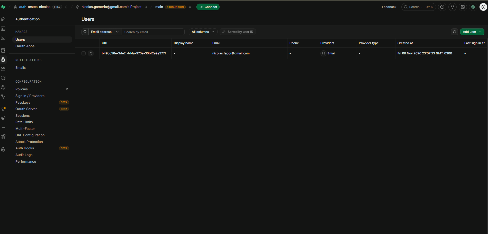

### Credenciais da API

Em **Project Settings → API Keys** obtive:

| Informação | Onde foi obtida | Uso nos testes |
|---|---|---|
| API URL | Integrations → Data API (`https://dihztjrqlbuvlsfbuqhj.supabase.co`) | `base_url` do Postman |
| API KEY (anon / pública) | Project Settings → API Keys | headers `apikey` e `Authorization` |

> Por segurança, as chaves aparecem parcialmente ocultas nos prints. A chave usada é a **anon (pública)**, nunca a `service_role` nem a *secret key*.

O Supabase hoje mostra por padrão as novas chaves (*publishable* `sb_publishable_...` e *secret* `sb_secret_...`) e avisa que as chaves legadas serão desativadas no início de 2027. Para os testes usei a chave **anon legada** (botão *View legacy API keys*). Ela é um JWT e funciona tanto no header `apikey` quanto no `Authorization: Bearer`, como pede o enunciado.

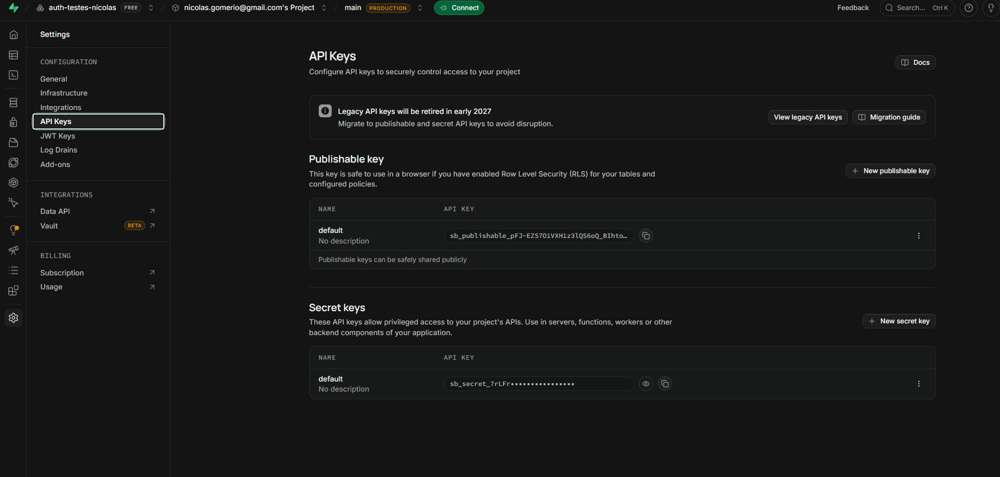
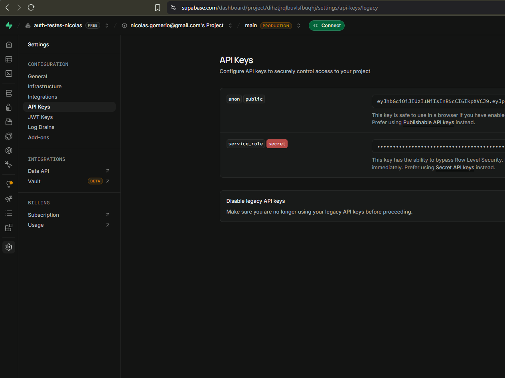

O painel mostra a API URL com o sufixo `/rest/v1/`, que é a rota da API do banco (PostgREST). Na `base_url` usei só o domínio do projeto, porque o serviço de autenticação fica em outra rota, `/auth/v1`.

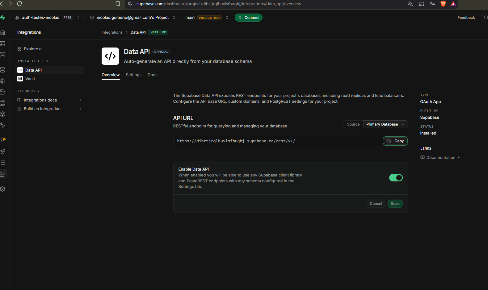
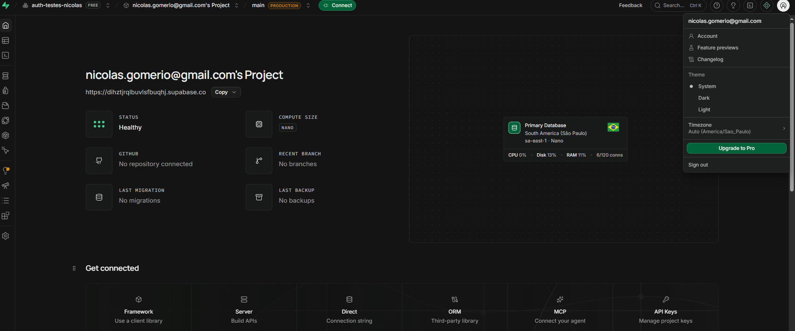

### Objetivo da configuração

Essa configuração prepara um serviço de autenticação real com um usuário conhecido. Assim é possível comparar o comportamento esperado da API com o comportamento obtido, em cenários de sucesso e de falha.

# Configuração do Postman

### Workspace

No Postman Desktop criei o workspace **Testes Supabase - Nicolas** (Workspaces → Create Workspace → Blank workspace), do tipo **Internal**, para não expor a chave e a senha publicamente, e para manter os artefatos desta atividade separados de outros projetos.

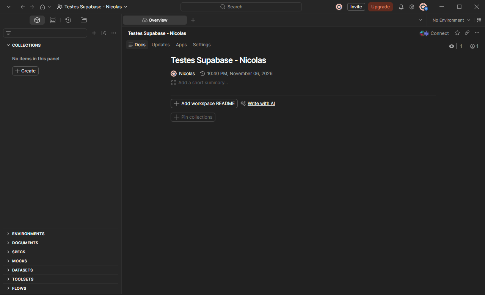

### Environment

Criei o environment **Supabase Auth - Nicolas** com as variáveis abaixo. O arquivo exportado está em [`/postman/supabase-auth.postman_environment.json`](postman/supabase-auth.postman_environment.json), com os valores reais substituídos por marcadores.

| Variável | Descrição | Tipo |
|---|---|---|
| `base_url` | URL da API do Supabase | default |
| `api_key` | API KEY (anon) do projeto | secret |
| `email` | E-mail do usuário criado | default |
| `password` | Senha do usuário criado | secret |
| `access_token` | Preenchida automaticamente após o login válido | secret |

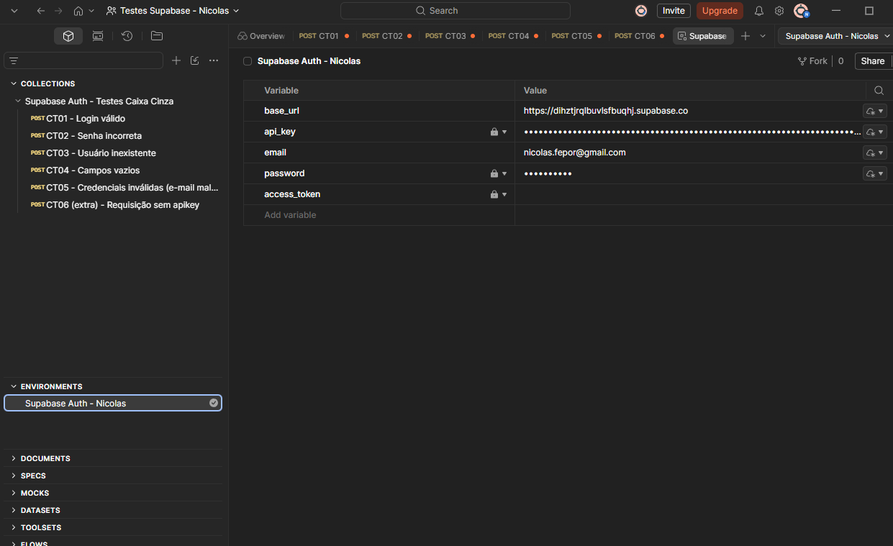

### Finalidade das variáveis

As variáveis evitam repetir URL, chave e credenciais em cada requisição. Se algum valor mudar, basta alterar em um lugar só. Elas também deixam os dados sensíveis fora da collection, que pode ser compartilhada no GitHub sem expor a chave ou a senha.

### Uso do Postman nos testes

Montei uma collection chamada **Supabase Auth - Testes Caixa Cinza**, com uma requisição para cada cenário. Cada requisição tem scripts na aba **Scripts → Post-response** que validam automaticamente o status HTTP, o conteúdo do JSON e a presença ou ausência do token. Executei as requisições uma a uma, conferindo a resposta e a aba *Test Results* de cada uma. A collection exportada está em [`/postman/supabase-auth.postman_collection.json`](postman/supabase-auth.postman_collection.json).

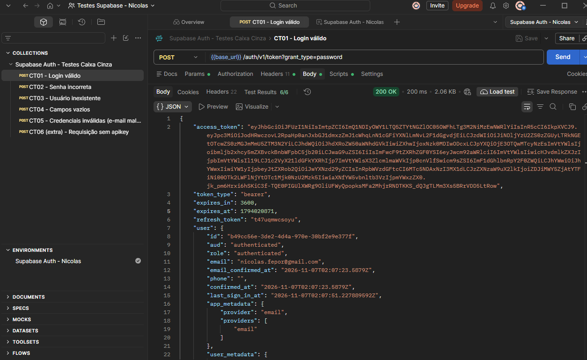

# Configuração das Requisições

| Item | Valor |
|---|---|
| Endpoint | `{{base_url}}/auth/v1/token?grant_type=password` |
| Método HTTP | `POST` |
| Finalidade | Autenticar um usuário por e-mail e senha e obter um `access_token` (JWT) |

O parâmetro `grant_type=password` informa ao serviço de autenticação que o login será feito com e-mail e senha.

### Exemplo de Header

| Header | Valor | Função |
|---|---|---|
| `apikey` | `{{api_key}}` (ex.: `eyJhbGciOi...XXXXX`) | Identifica o projeto Supabase e autoriza o acesso à API |
| `Authorization` | `Bearer {{api_key}}` | Envia a chave no padrão Bearer exigido pelo gateway |
| `Content-Type` | `application/json` | Informa que o corpo está em JSON |

### Exemplo do Body JSON

```json
{
  "email": "usuario@email.com",
  "password": "123456"
}
```

No Postman, o body usa as variáveis do environment:

```json
{
  "email": "{{email}}",
  "password": "{{password}}"
}
```

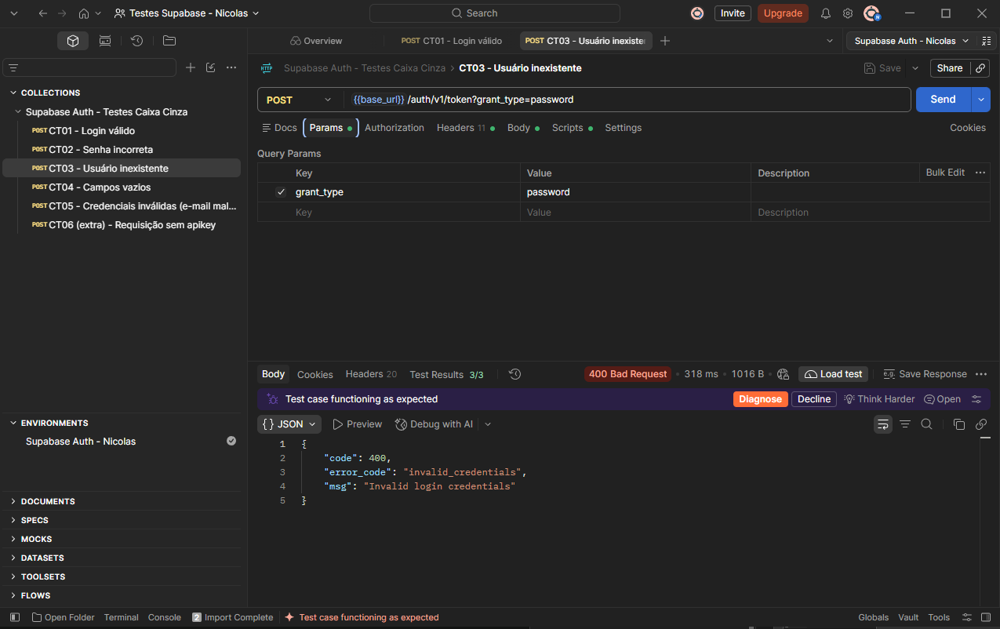
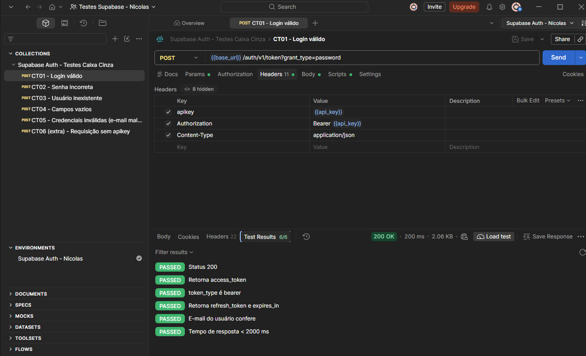
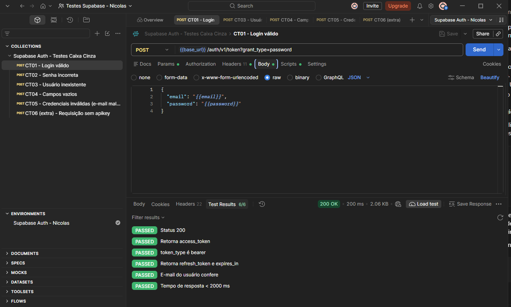

# Execução dos Testes

Foram executados os 5 cenários obrigatórios e um cenário extra (sem `apikey`). Em cada um validei o **status HTTP**, o **JSON de resposta**, a **mensagem de erro**, a presença ou ausência do **access token** e o **comportamento da autenticação**.

### Tabela de Cenários

| Cenário | Entrada Utilizada | Resultado Esperado | Resultado Obtido | Status |
|---|---|---|---|---|
| CT01 – Login válido | E-mail e senha do usuário cadastrado | Status 200 + access token | 200 OK, `access_token`, `refresh_token` e dados do usuário (6/6 testes) | OK |
| CT02 – Senha incorreta | E-mail válido + `SenhaErrada@999` | Erro de autenticação | 400, `invalid_credentials` – "Invalid login credentials" (3/3) | OK |
| CT03 – Usuário inexistente | `naoexiste.teste@email.com` + `Qualquer@123` | Acesso negado | 400, `invalid_credentials` – "Invalid login credentials" (3/3) | OK |
| CT04 – Campos vazios | `email: ""`, `password: ""` | Erro de validação | 400, `validation_failed` – "missing email or phone" (3/3) | OK |
| CT05 – Credenciais inválidas | `emailinvalido` + `123` | Mensagem de erro | 400, `invalid_credentials` – "Invalid login credentials" (3/3) | OK |
| CT06 – Sem apikey (extra) | Credenciais válidas, sem header `apikey` | Status 401 | 401, "No API key found in request" (2/2) | OK |

### Detalhes e evidências

**CT01 – Login válido:** a API retornou **200 OK** em cerca de 200 ms, e os 6 testes automáticos da requisição passaram (6/6). O JSON trouxe o `access_token` (JWT), `token_type: "bearer"`, `expires_in: 3600` (o token vale 1 hora), `expires_at`, `refresh_token` e o objeto `user`. O `user.id` (`b49cc56e-3de2-4d4a-970e-30bf2e9e377f`) é o mesmo UID do usuário no painel do Supabase, `email_confirmed_at` mostra que o e-mail estava confirmado e `last_sign_in_at` registrou o horário desse login.


**CT02 – Senha incorreta:** a API retornou **400 Bad Request** com `"error_code": "invalid_credentials"` e `"msg": "Invalid login credentials"`, sem nenhum token. Os 3 testes automáticos passaram (3/3).

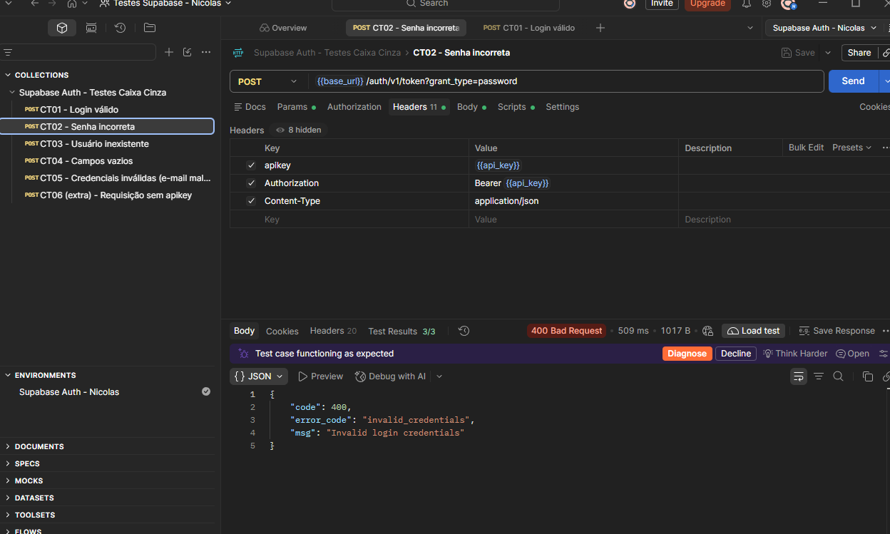

**CT03 – Usuário inexistente:** a API retornou **400 Bad Request** com `invalid_credentials` e a mensagem "Invalid login credentials", sem token (3/3). A resposta é **idêntica** à do CT02 (senha incorreta). Isso é intencional: com uma mensagem genérica, quem tenta atacar não consegue descobrir quais e-mails estão cadastrados (proteção contra enumeração de usuários).


**CT04 – Campos vazios:** a API retornou **400 Bad Request** com `"error_code": "validation_failed"` e `"msg": "missing email or phone"` (3/3). Aqui o erro é de **validação**, e não de credenciais: a requisição foi barrada antes de qualquer verificação de senha.

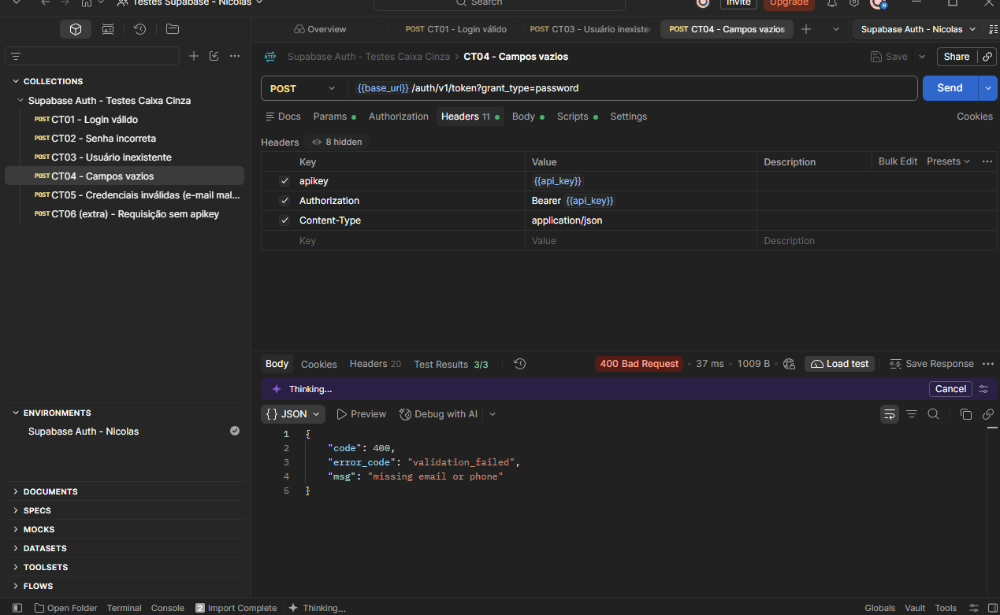

**CT05 – Credenciais inválidas:** com um e-mail sem formato válido (`emailinvalido`) e uma senha curta (`123`), a API retornou **400 Bad Request** com `invalid_credentials` – "Invalid login credentials" (3/3). O acesso foi negado, mas a API **não acusou o formato inválido do e-mail**: tratou o caso como credencial errada.

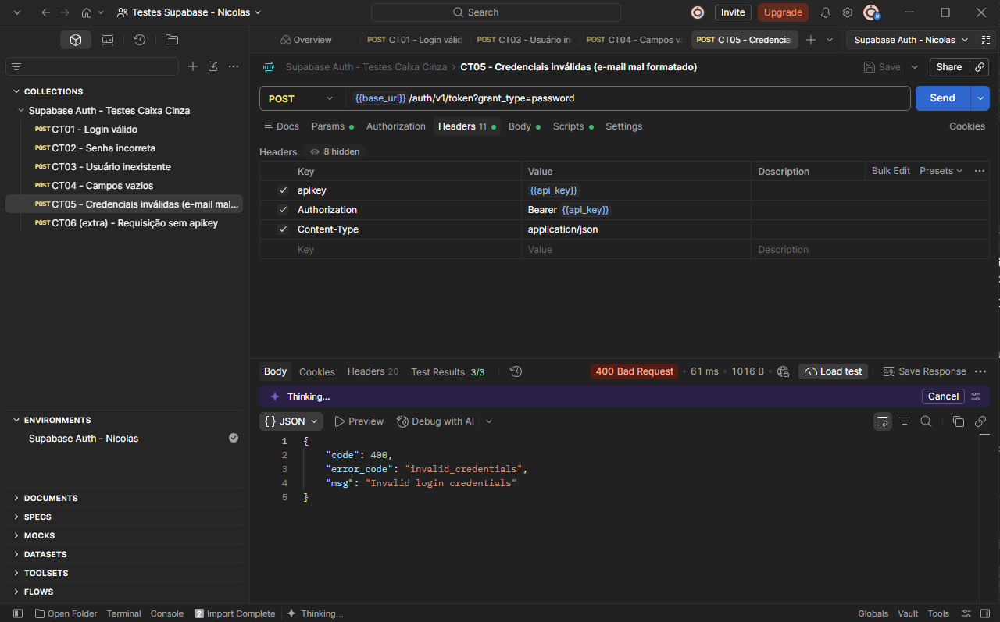

**CT06 – Sem apikey:** sem o header `apikey`, a requisição foi barrada no gateway da API com **401 Unauthorized** e a mensagem "No API key found in request" (2/2), antes mesmo de chegar ao serviço de autenticação.

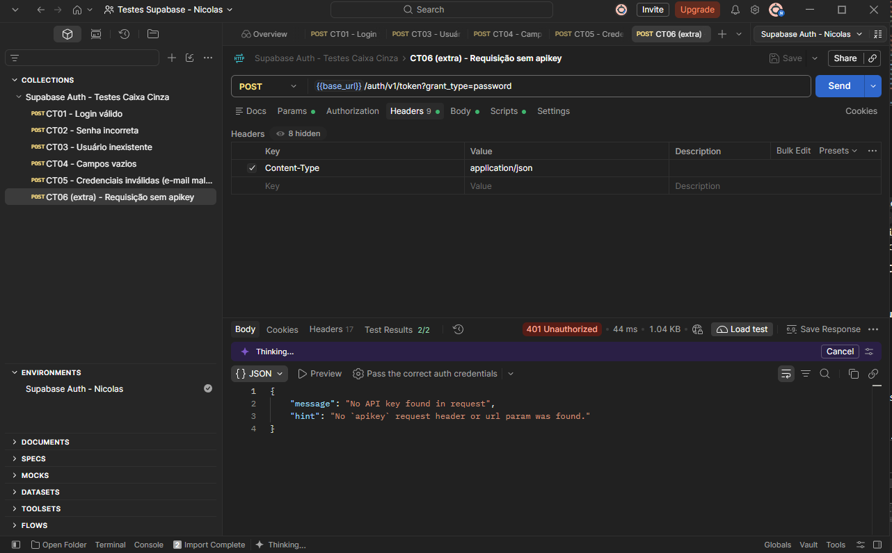

### Erros encontrados

Nenhum cenário permitiu acesso indevido, e todos os testes automáticos passaram. Mesmo assim, encontrei diferenças entre o que o enunciado esperava e o comportamento real da API:

- **Código HTTP genérico:** "Senha incorreta", "Usuário inexistente" e "Credenciais inválidas" retornam o mesmo **400 Bad Request**. Pela semântica HTTP, uma falha de autenticação costuma ser **401 Unauthorized**.
- **"Acesso negado" sem 401/403:** para usuário inexistente, a API não retorna 401 nem 403, e sim 400 com a mesma mensagem do erro de senha.
- **Sem validação de formato do e-mail:** no CT05, um e-mail sem `@` não gerou erro de validação. Só os campos vazios (CT04) geraram `validation_failed`.

Erros de configuração que apareceram durante a preparação (e foram corrigidos):

- `401 – Invalid API key` e `401 – No API key found in request`: a chave não estava sendo enviada corretamente, porque a aba *Authorization* do Postman tinha sido alterada para "API Key" com campos vazios. Corrigi deixando *No Auth* e mantendo os headers manuais.
- `400 – invalid_credentials` no login válido: o valor da senha usado pelo Postman (valor local da variável) estava diferente do exibido. Usei o **Console** do Postman para ver o corpo realmente enviado, identifiquei a diferença e corrigi.

# Registro dos Testes

Os testes foram registrados na planilha [`/planilha/planilha-testes.xlsx`](planilha/planilha-testes.xlsx), com os campos: **ID do teste, Cenário, Entrada, Resultado esperado, Resultado obtido, Status (Sucesso/Falha) e Observações**. O resultado esperado foi preenchido **antes** da execução e o resultado obtido **depois**, a partir das respostas reais do Postman. Assim a comparação entre os dois é objetiva.

Exemplo de registro:

| ID | Cenário | Entrada | Resultado esperado | Resultado obtido | Status | Observações |
|---|---|---|---|---|---|---|
| CT01 | Login válido | Usuário cadastrado | Status 200 + access_token | 200 OK, token JWT válido por 3600 s | Sucesso | `user.id` igual ao UID do painel |
| CT02 | Senha incorreta | Senha errada | Status 400, sem token | 400 `invalid_credentials` | Sucesso | Mesma mensagem do CT03 (anti-enumeração) |

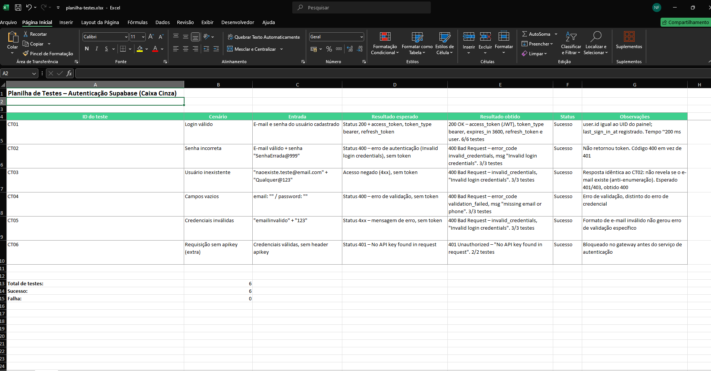

### Importância da documentação dos testes

Documentar os testes garante **rastreabilidade**: qualquer pessoa consegue saber o que foi testado, com quais dados e qual foi o resultado. A documentação também permite **repetir** os testes depois de uma mudança no sistema (teste de regressão), serve de **evidência** em auditorias e facilita a comunicação de falhas para a equipe de desenvolvimento.

### Falhas identificadas

Os 6 testes tiveram status **Sucesso**: em nenhum caso a API se comportou de forma insegura. As observações registradas na planilha foram: o uso de **400** em vez de **401** para credenciais incorretas, a mesma mensagem para senha errada e usuário inexistente (proposital, por segurança) e a falta de validação do formato do e-mail.

# Resultados Obtidos

| Total de testes | Sucesso | Falha |
|---|---|---|
| 6 | 6 | 0 |

O único cenário com credenciais corretas (CT01) foi o único a receber **200 OK** e um `access_token` JWT válido por 3600 segundos. O `user.id` retornado é o mesmo UID cadastrado no painel do Supabase. Todos os outros cenários foram bloqueados **sem emitir token**:

| Situação | Status | `error_code` / mensagem |
|---|---|---|
| Login correto | 200 | – (retorna token) |
| Senha errada / usuário inexistente / e-mail inválido | 400 | `invalid_credentials` – Invalid login credentials |
| Campos vazios | 400 | `validation_failed` – missing email or phone |
| Sem chave de API | 401 | No API key found in request |

Na soma, foram **6 cenários e 20 asserções automáticas**, e todas passaram. A autenticação se mostrou segura: ela não revela se o usuário existe e diferencia erro de validação de erro de credencial. Os pontos de melhoria estão na semântica dos códigos HTTP.

# Conclusão

**Execução dos testes:** todos os 6 cenários (os 5 obrigatórios e 1 extra) foram executados no Postman Desktop contra o meu projeto no Supabase, com validação automática por scripts de teste. Todas as asserções passaram.

**Funcionamento da autenticação:** a autenticação funcionou. O login válido gerou um `access_token` JWT, e todas as tentativas inválidas foram recusadas sem emitir token.

**Dificuldades encontradas:** Encontrar a chave **anon**, que hoje fica escondida em *View legacy API keys* porque o Supabase passou a mostrar por padrão as novas chaves *publishable*. Entender que a API URL do painel (`/rest/v1/`) não era a base certa para a autenticação. Lidar com o assistente de IA do Postman, que alterou a aba *Authorization* e removeu os headers, causando erros 401. E descobrir, pelo Console do Postman, que a senha enviada era diferente da exibida no environment, o que causava `invalid_credentials` mesmo no login válido.

**Falhas identificadas:** nenhuma falha de segurança. As observações foram o código **400** usado para credenciais incorretas, onde **401** seria mais adequado, e a ausência de validação do formato do e-mail.

**Melhorias que poderiam ser implementadas:**
- usar códigos HTTP mais específicos: **401** para credenciais inválidas e **422** para erros de validação;
- validar o formato do e-mail antes de consultar a base de usuários;
- revisar os limites de tentativas de login (*Rate Limits* e *Attack Protection*, com CAPTCHA) contra ataques de força bruta;
- exigir política de senha forte no cadastro;
- migrar da chave anon legada para a *publishable key*, já que as chaves legadas serão desativadas em 2027;
- automatizar a collection com o **Newman** em um pipeline de CI, para rodar os testes a cada mudança.

**Importância dos testes caixa cinza em APIs:** o teste caixa cinza junta a visão do usuário (caixa preta) com o conhecimento parcial da estrutura (caixa branca). Conhecer o endpoint, os headers e o formato das respostas permite criar cenários mais direcionados, como requisições sem chave, campos vazios ou dados mal formatados, sem precisar do código-fonte. Em APIs de autenticação isso é essencial, porque falhas nessa camada podem expor dados e contas de usuários.

---

### Arquivos

- Collection: [`postman/supabase-auth.postman_collection.json`](postman/supabase-auth.postman_collection.json)
- Environment: [`postman/supabase-auth.postman_environment.json`](postman/supabase-auth.postman_environment.json)
- Planilha: [`planilha/planilha-testes.xlsx`](planilha/planilha-testes.xlsx)
- Evidências: [`prints/`](prints/)
